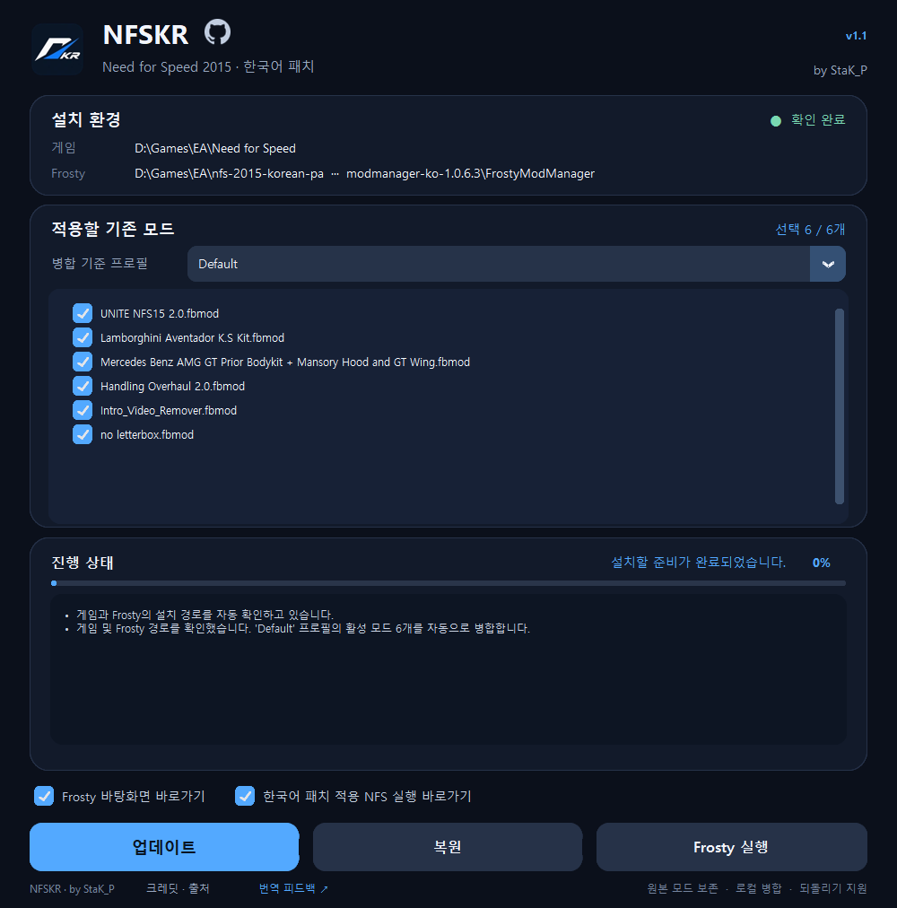
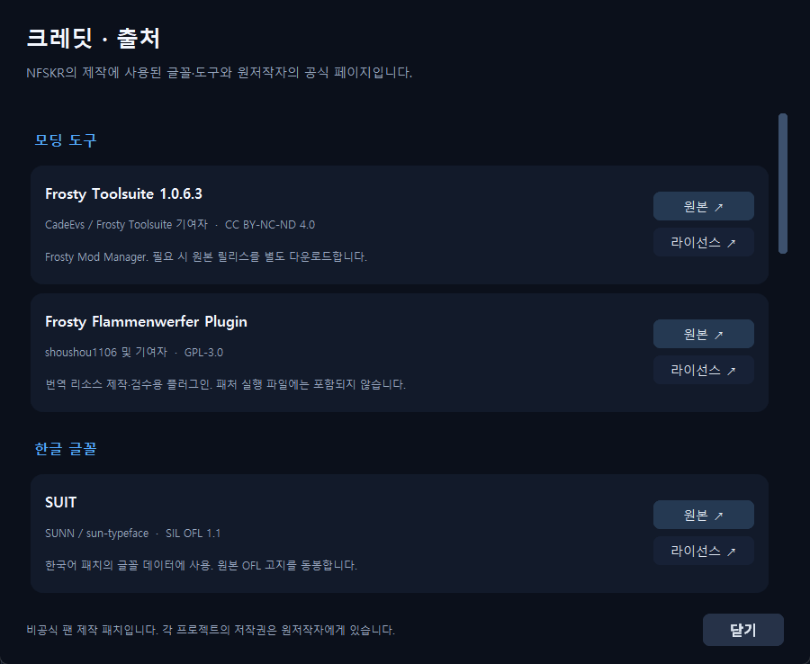

# NFSKR
### Need for Speed (2015) 한국어 패치

2015년작 **Need for Speed**를 한국어로 즐기기 위한 비공식 팬 제작 패치

**v1.1** · Windows x64 · 제작 **StaK_P**

**[⬇️ v1.1 설치파일 받기](https://github.com/StaK-P/Need-For-Speed-2015-Korean-Patch/releases/tag/v1.1)**　 ·　 **[💬 번역 피드백 보내기](https://github.com/StaK-P/Need-For-Speed-2015-Korean-Patch/issues/new?template=translation-feedback.yml)**

---

## 주요 기능

- **한국어 번역 8,206개 문자열 ID**: 게임 메뉴, 안내, 스토리 등을 한국어로 번역했어.
- **원클릭 설치**: Windows에서 게임과 Frosty Mod Manager를 자동 감지하고 필요한 도구·한글 글꼴을 준비해.
- **기존 모드 유지**: Frosty 원본 프로필에서 사용할 모드만 선택하고 한국어 패치와 로컬 병합해.
- **안전한 업데이트**: 새 번역이나 모드 추가 후 기존 `NFSKR`/`NFSKR-2` 프로필 **이름을 유지하면서 재적용**할 수 있어. 프로필이 무한 증식하지 않아.
- **직전 버전 복원**: 업데이트 이전 합본을 보존하고 `복원` 버튼으로 이전 모드/번역 구성으로 돌아갈 수 있어.
- **출처와 피드백**: 크레딧 · 출처와 GitHub **번역 피드백 ↗** 버튼을 지원해.

## 설치 프로그램 미리보기

*실제 설치기 화면. 원본 모드 선택, 설치 환경, 진행 상황과 업데이트·복원·Frosty 실행 버튼을 한눈에 볼 수 있어.*

## 설치 가이드

1. **정품 Need for Speed (2015)**를 PC에 설치하고 게임과 Frosty Mod Manager를 모두 종료해.
2. **[GitHub Releases의 v1.1](https://github.com/StaK-P/Need-For-Speed-2015-Korean-Patch/releases/tag/v1.1)**에서 `NFSKR-Setup.exe`를 내려받아 실행해. 별도로 Python을 설치할 필요는 없어.
3. 설치기가 게임과 Frosty 경로를 찾는 동안 기다려. Frosty가 없다면 공식 배포처에서 필요한 구성요소를 다운로드하도록 안내해.
4. **병합 기준 프로필**에서 기존 Frosty 원본 프로필(예: `Default`)을 골라. 한국어 패치에 함께 적용할 모드를 체크해.
5. 처음이면 **설치**, 기존 한국어 패치가 있으면 **업데이트** 버튼을 누르고, 진행률이 **패치 완료 · 100%**가 될 때까지 기다려.
6. **Frosty 실행** 버튼이나 만들어진 한국어 패치 전용 바탕화면 바로가기로 게임을 실행해.

> 게임 `NFS16.exe`를 직접 실행하면 Frosty 프로필이 적용되지 않을 수 있어. 필요한 권한 및 정상 작동 여부는 PC 환경에 따라 달라.

## 모드를 추가하거나 최신 번역으로 재적용

1. Frosty에서 **원본 프로필**(`Default` 등)에 원하는 새로운 모드를 추가해. NFSKR로 생성된 합본 프로필에 수동으로 추가하진 마.
2. Frosty와 게임을 완전히 종료한 다음 설치기를 다시 실행해.
3. 새로 불러온 모드 목록에서 포함할 항목을 선택하고 **업데이트**를 눌러.
4. 업데이트가 끝나면 기존 `NFSKR-2` 같은 프로필 이름과 해당 게임 바로가기는 유지돼.
5. 변경 후 문제가 생기면 게임/Frosty를 닫고 설치기의 **복원**을 눌러 직전 상태로 돌아가.

서드파티 모드끼리 지원되지 않는 바이너리 충돌이 있거나 원본 설정이 실행 중 변경됐다면, 안전을 위해 업데이트를 중단할 수 있어. 어떤 모드든 100% 호환되는 것은 아니야.

## 번역 피드백 보내기

**[📝 번역 피드백 전용 이슈 양식 열기](https://github.com/StaK-P/Need-For-Speed-2015-Korean-Patch/issues/new?template=translation-feedback.yml)**

게임에서 어색한 번역이나 오역, 이름·용어 표기 오류를 발견했다면 **번역 피드백 ↗** 버튼으로 알려줘. 양식에는 **등장 상황, 현재 번역, 제안 문구, 스크린샷, 패치 버전**을 적으면 돼.

v1.1에서는 초반 마누의 본명 `에마누엘` / `이매뉴얼`을 **`엠마누엘`**로 통일했어(문자열 ID 2개, 3곳).

## 출처와 크레딧

설치기 아래쪽 **크레딧 · 출처**를 누르면 SUIT·SUITE·Pretendard, Frosty Toolsuite, 사용 라이브러리의 제작자·원본 링크·라이선스를 확인할 수 있어. 상세 정보는 [THIRD_PARTY_NOTICES.md](THIRD_PARTY_NOTICES.md)에도 정리했어.

## 호환성 및 주의

- **Windows x64**, **NFS16 v366510** 기준으로 개발했어.
- 실제 모드 6개·총 **4,378개 리소스**의 정적 병합 검증을 통과했지만, 모든 PC/모드 조합의 실제 실행을 보증하는 것은 아니야.
- 설치파일은 **게임 원본 데이터나 EA 폰트, 타사 FBMod를 포함하지 않아.** 필요한 리소스는 사용자 PC에 설치된 정품 게임을 바탕으로 로컬에서 만들어.
- 특정 PC에서 시험한 **무선 Xbox 패드 DirectInput 호환성 수정** 및 **EPYC 7T83용 성능 `user.cfg`**는 다른 환경에 부작용이 있을 수 있어 일반 설치기에 넣지 않았어.
- NFS 2015는 온라인 접속이 필요한 게임이야. 외부 서비스, 모드 및 게임 버전에 따라 작동 여부가 달라질 수 있어.
- 이 프로젝트는 **EA와 무관한 비공식 팬 번역 프로젝트**야. Need for Speed와 관련 게임 자산의 권리는 각 권리자에게 있어.

## 소스 공개와 빌드

`tools/`에 설치기·병합기 Python 원본, `native/`에 보조 C# 소스, `translations/`에 **원문 영어 게임 데이터가 제외된 한국어 번역·검수 자료**, `tests/`에 테스트 코드가 있어. [빌드 안내](docs/BUILDING.md)와 [번역 데이터 설명](translations/README.md)을 참고해.

일부 프로그램과 글꼴은 [공식 배포처](THIRD_PARTY_NOTICES.md)에서 별도로 준비해야 하며, 개발·분석 환경은 로컬에 정품 게임이 설치되어 있어야 해.

---

NFSKR v1.1 · by StaK_P · 2026

